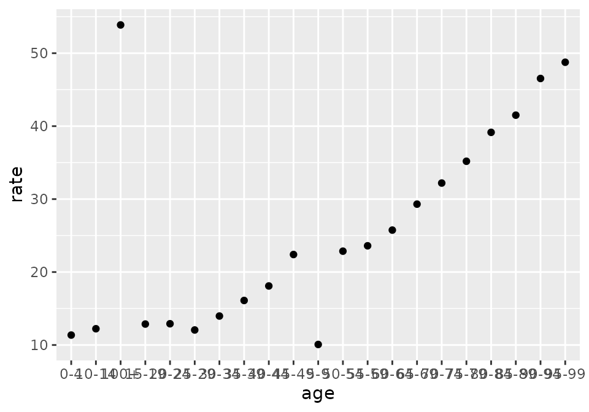
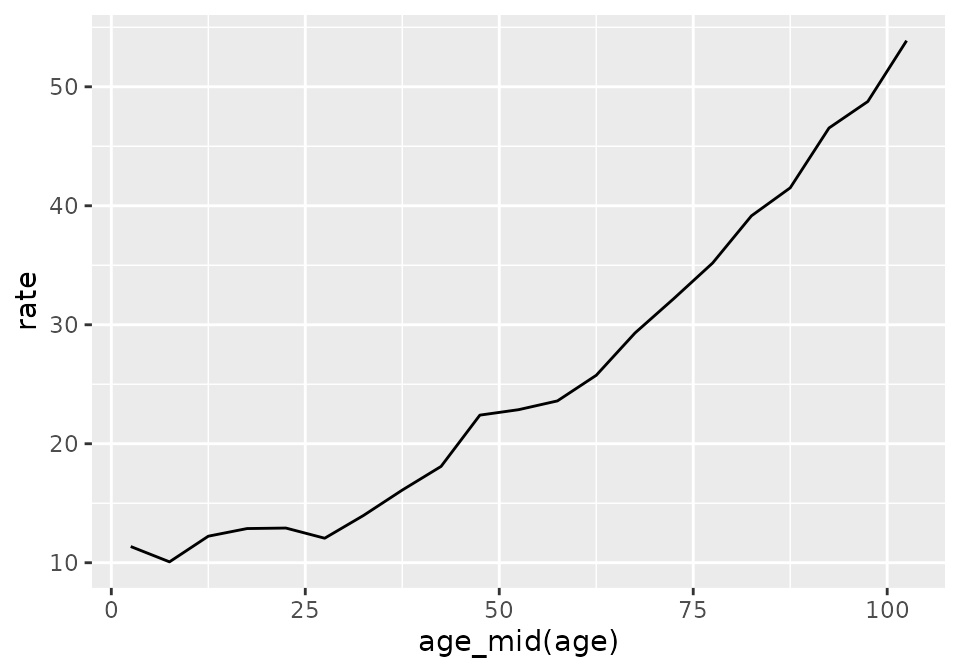

# Cookbook

This vignette provides recipes for common tasks involving age group,
period, and cohort labels. Each recipe describes a problem and gives a
solution. For an overview of the `agetime` package, see [Get
started](https://bayesiandemography.github.io/agetime/articles/agetime.md).

``` r

library(agetime)
library(dplyr, warn.conflicts = FALSE)
library(ggplot2)
set.seed(0)
```

## Create and modify labels

### Create labels from scratch

#### Problem

You need a new set of age group, period, or cohort labels.

#### Solution

For labels with regular widths, use functions such as
[`age_labels_ten()`](https://bayesiandemography.github.io/agetime/reference/age_labels.md)
or
[`period_labels_five()`](https://bayesiandemography.github.io/agetime/reference/period_labels.md).

``` r

age_labels_ten()
#>  [1] "0-9"   "10-19" "20-29" "30-39" "40-49" "50-59" "60-69" "70-79" "80-89"
#> [10] "90-99" "100+"
period_labels_five(
  lower_first = 2001,
  lower_last = 2031
)
#> [1] "2001-2006" "2006-2011" "2011-2016" "2016-2021" "2021-2026" "2026-2031"
#> [7] "2031-2036"
```

For labels with irregular widths, use
[`age_labels()`](https://bayesiandemography.github.io/agetime/reference/age_labels.md),
[`period_labels()`](https://bayesiandemography.github.io/agetime/reference/period_labels.md),
or
[`cohort_labels()`](https://bayesiandemography.github.io/agetime/reference/cohort_labels.md),
and specify the breaks.

``` r

age_labels(
  breaks = c(0, 20, 65, 100)
)
#> [1] "0-19"  "20-64" "65-99" "100+"
cohort_labels(
  breaks = c(2000, 2010, 2030),
  open_left = TRUE
)
#> [1] "<2000"     "2000-2010" "2010-2030"
```

#### Discussion

There is no universally accepted set of conventions on how age, period,
and cohort labels should be formatted. `agetime` tries to reflect common
practices in demography and official statistics.

#### See Also

- The help pages for
  [`age_labels()`](https://bayesiandemography.github.io/agetime/reference/age_labels.md),
  [`period_labels()`](https://bayesiandemography.github.io/agetime/reference/period_labels.md),
  and
  [`cohort_labels()`](https://bayesiandemography.github.io/agetime/reference/cohort_labels.md)
  describe `agetime` formatting rules

### Standardize labels

#### Problem

Your age, period, or cohort labels come in a mix of formats, such as
`"5to9"`, `"10--14"`, and `"100plus"`, and you want them all in one
consistent format.

#### Solution

Use
[`age_standard()`](https://bayesiandemography.github.io/agetime/reference/age_standard.md),
[`period_standard()`](https://bayesiandemography.github.io/agetime/reference/period_standard.md),
or
[`cohort_standard()`](https://bayesiandemography.github.io/agetime/reference/cohort_standard.md).

``` r

df <- tibble(
  age = c("5to9", "10--14", "100plus", "infants"),
  count = c(11, 9, 2, 22)
)

df |>
  mutate(age = age_standard(age))
#> # A tibble: 4 × 2
#>   age   count
#>   <chr> <dbl>
#> 1 5-9      11
#> 2 10-14     9
#> 3 100+      2
#> 4 0        22
```

The `standard` functions recognize the formats commonly found in
published tables, including totals and not-stated categories.

``` r

age_standard(c("All ages", "Under 1", "1-4 years", "Age 5 to 9",
               "10-14yrs", "85 years and over", "Not stated"))
#> [1] "Total" "0"     "1-4"   "5-9"   "10-14" "85+"   NA
```

#### Discussion

If the `labels` argument is a factor, then the `standard` functions
standardize the factor levels along with the values.

Not-stated categories become `NA`. To remove them, see [Drop “Not
stated” categories from a dataset](#drop-missing).

#### See Also

- The help pages for
  [`age_standard()`](https://bayesiandemography.github.io/agetime/reference/age_standard.md),
  [`period_standard()`](https://bayesiandemography.github.io/agetime/reference/period_standard.md),
  and
  [`cohort_standard()`](https://bayesiandemography.github.io/agetime/reference/cohort_standard.md)
  describe `agetime` formatting rules

### Convert lower limits to age group labels

#### Problem

Your data store age groups as numbers, such as `0`, `5`, `10`, …, `85`,
where each number is the lower limit of a five-year age group, and `85`
is the lower limit of an open age group. You want age group labels such
as `"0-4"` and `"85+"`.

#### Solution

Treat the numbers as single years, coarsen them to five-year groups, and
then make the last group open.

``` r

age <- c(0, 5, 10, 80, 85)
age |>
  age_coarsen_five() |>
  age_set_open_right(at = 85)
#> [1] 0-4   5-9   10-14 80-84 85+  
#> Levels: 0-4 5-9 10-14 80-84 85+
```

For life-table age groups, where the numbers are `0`, `1`, `5`, `10`, …,
use
[`age_coarsen_life()`](https://bayesiandemography.github.io/agetime/reference/age_coarsen_five.md)
in place of
[`age_coarsen_five()`](https://bayesiandemography.github.io/agetime/reference/age_coarsen_five.md).

#### Discussion

`agetime` reads a number on its own as a single year of age. Without
coarsening, `5` is the interval from age 5 up to age 6, not up to age
10.

``` r

age_interval(age)
#> [1] "[0, 1)"   "[5, 6)"   "[10, 11)" "[80, 81)" "[85, 86)"
```

#### See Also

- [Aggregate to broader age groups](#aggregate-to-broader-age-groups)
- [Specify an open-ended age group, period, or
  cohort](#specify-an-open-ended-age-group-period-or-cohort)

### Adopt coarser age groups from another age variable

#### Problem

You have two age variables, and you want to switch the finer one to the
coarser age groups used by the other.

#### Solution

Use
[`age_coarsen_to()`](https://bayesiandemography.github.io/agetime/reference/age_coarsen_to.md).

``` r

df <- tibble(
  age = c("0", "1", "5", "10", "11"),
  n = c(3, 1, 4, 6, 7)
)
age_wide <- c("0-4", "5-14")

df |>
  mutate(age = age_coarsen_to(age, to = age_wide)) |>
  count(age, wt = n)
#> # A tibble: 2 × 2
#>   age       n
#>   <fct> <dbl>
#> 1 0-4       4
#> 2 5-14     17
```

#### Discussion

Every age group in `labels` must lie inside exactly one age group in
`to`. Otherwise
[`age_coarsen_to()`](https://bayesiandemography.github.io/agetime/reference/age_coarsen_to.md)
throws an error, which distinguishes two problems:

- an age group *would be split* when it overlaps two or more age groups
  in `to`, as `"5-9"` overlaps `"0-6"` and `"7-14"`;
- an age group is *not fully covered* when part of it lies outside all
  the age groups in `to`, as `"20"` lies above `"7-14"`.

``` r

age_coarsen_to(c("0-4", "5-9", "20"), to = c("0-6", "7-14"))
#> Error in `age_coarsen_to()`:
#> ! Can't coarsen age groups.
#> ✖ Age group "5-9" would be split by the labels in `to`.
#> ℹ "5-9" overlaps "0-6" and "7-14".
#> ✖ Age group "20" is not fully covered by the labels in `to`.
#> ℹ Add labels to `to` that cover it?
```

#### See Also

- [Aggregate to broader age groups](#aggregate-to-broader-age-groups)
- [Build a mapping between age
  groups](#build-a-mapping-between-age-groups)
- [`period_coarsen_to()`](https://bayesiandemography.github.io/agetime/reference/period_coarsen_to.md),
  [`cohort_coarsen_to()`](https://bayesiandemography.github.io/agetime/reference/cohort_coarsen_to.md)

### Create labels for a forecast

#### Problem

You have labels for past periods, and you need labels for future
periods, for use in a forecast.

#### Solution

Use
[`period_extend()`](https://bayesiandemography.github.io/agetime/reference/period_extend.md).

``` r

recent <- c("2020-2025", "2025-2030")
period_extend(recent, n = 2)
#> [1] "2020-2025" "2025-2030" "2030-2035" "2035-2040"
```

#### See Also

- [`age_extend()`](https://bayesiandemography.github.io/agetime/reference/age_extend.md)
  extends age groups and
  [`cohort_extend()`](https://bayesiandemography.github.io/agetime/reference/cohort_extend.md)
  extends cohorts.

### Specify an open-ended age group, period, or cohort

#### Problem

You want an open interval at one end of your labels, with a limit
specified by you. The labels might already have an open interval with a
different limit, or they might not have one at all.

An open interval is one that has no lower limit (e.g. `"<2000"`) or no
upper limit (e.g. `"85+"`).

#### Solution

Use

- [`age_set_open_right()`](https://bayesiandemography.github.io/agetime/reference/age_set_open_right.md),
- [`period_set_open_left()`](https://bayesiandemography.github.io/agetime/reference/period_set_open_left.md),
- [`period_set_open_right()`](https://bayesiandemography.github.io/agetime/reference/period_set_open_left.md),
- [`cohort_set_open_left()`](https://bayesiandemography.github.io/agetime/reference/cohort_set_open_left.md),
  or
- [`cohort_set_open_right()`](https://bayesiandemography.github.io/agetime/reference/cohort_set_open_left.md).

``` r

labels_age <- c("0-4", "60-64", "90+")
age_set_open_right(labels_age, at = 80)
#> [1] 0-4   60-64 80+  
#> Levels: 0-4 60-64 80+
```

#### Discussion

The `set_open` functions always return factors. If you would prefer a
character vector, call
[`as.character()`](https://rdrr.io/r/base/character.html) on the result,

``` r

labels_age |>
  age_set_open_right(at = 80) |>
  as.character()
#> [1] "0-4"   "60-64" "80+"
```

#### See Also

- Use
  - [`age_is_open_right()`](https://bayesiandemography.github.io/agetime/reference/age_is_open_right.md),
  - [`period_is_open_left()`](https://bayesiandemography.github.io/agetime/reference/period_is_open_left.md),
  - [`period_is_open_right()`](https://bayesiandemography.github.io/agetime/reference/period_is_open_left.md),
  - [`cohort_is_open_left()`](https://bayesiandemography.github.io/agetime/reference/cohort_is_open_left.md),
    or
  - [`cohort_is_open_right()`](https://bayesiandemography.github.io/agetime/reference/cohort_is_open_left.md)

  to identify open intervals.
- The `coarsen`, `fill`, and `set_order` functions, like the `set_open`
  functions, always return factors

### Create an age variable that sorts properly

#### Problem

Raw age group labels sort in alphabetical order:

``` r

df <- tibble(
  age = c("10-14", "0-4", "5-9"),
  count = c(33, 7, 15)
)

df |>
  arrange(age) ## "10-14" comes before "5-9"!!
#> # A tibble: 3 × 2
#>   age   count
#>   <chr> <dbl>
#> 1 0-4       7
#> 2 10-14    33
#> 3 5-9      15
```

You want an age variable that sorts in age order.

#### Solution

Function
[`age_set_order()`](https://bayesiandemography.github.io/agetime/reference/age_set_order.md)
creates a factor with levels in the right order.

``` r

labels_unordered <- c("10-14", "0-4", "5-9")
age_set_order(labels_unordered)
#> [1] 10-14 0-4   5-9  
#> Levels: 0-4 5-9 10-14
```

#### Discussion

If `labels` is not a factor,
[`age_set_order()`](https://bayesiandemography.github.io/agetime/reference/age_set_order.md)
turns it into one.

#### See Also

- Use
  [`period_set_order()`](https://bayesiandemography.github.io/agetime/reference/period_set_order.md)
  and
  [`cohort_set_order()`](https://bayesiandemography.github.io/agetime/reference/cohort_set_order.md)
  to make period and cohort labels sort in the right order.
- [Order by age when working interactively](#sort-age-interactive)
- The `set_open`, `coarsen`, and `fill` functions, like the `set_order`
  functions, always return factors

### Ensure that all age groups appear in a table

#### Problem

You are building a table, and you want it to show every age group,
including age groups with no observations.

#### Solution

Generate the full set of labels with

- [`age_labels()`](https://bayesiandemography.github.io/agetime/reference/age_labels.md),
- [`age_labels_one()`](https://bayesiandemography.github.io/agetime/reference/age_labels.md),
- [`age_labels_five()`](https://bayesiandemography.github.io/agetime/reference/age_labels.md),
- [`age_labels_ten()`](https://bayesiandemography.github.io/agetime/reference/age_labels.md),
  or
- [`age_labels_life()`](https://bayesiandemography.github.io/agetime/reference/age_labels.md),

then join the data on to the set.

``` r

all_ages <- tibble(
  age = age_labels_five(
    lower_first = 0,
    lower_last = 20,
    open_right = FALSE
  )
)

observed <- tibble(
  age = c("0-4", "10-14"),
  n = c(30, 25)
)

all_ages |>
  left_join(observed, by = "age")
#> # A tibble: 5 × 2
#>   age       n
#>   <chr> <dbl>
#> 1 0-4      30
#> 2 5-9      NA
#> 3 10-14    25
#> 4 15-19    NA
#> 5 20-24    NA
```

Alternatively, to fill gaps between the age groups in the data, use a
`fill` function, then
[`complete()`](https://tidyr.tidyverse.org/reference/complete.html) from
the `tidyr` package.

``` r

library(tidyr)

observed |>
  mutate(age = age_fill_five(age)) |>
  complete(age, fill = list(n = 0))
#> # A tibble: 3 × 2
#>   age       n
#>   <fct> <dbl>
#> 1 0-4      30
#> 2 5-9       0
#> 3 10-14    25
```

[`complete()`](https://tidyr.tidyverse.org/reference/complete.html)
sorts character vectors alphabetically, so `age` needs to be a factor,
as it is here.

#### Discussion

[`age_labels_life()`](https://bayesiandemography.github.io/agetime/reference/age_labels.md)
creates the labels used by an abridged life table, `"0"`, `"1-4"`,
`"5-9"`, `"10-14"`, …

#### See Also

- Periods and cohorts have equivalent `labels` functions.
- The `fill` functions
  (e.g. [`age_fill_five()`](https://bayesiandemography.github.io/agetime/reference/age_fill.md))
  add intermediate levels to a factor.
- [Create an age variable that sorts properly](#sort-age-permanently)
- [Include levels that don’t appear in the data](#fill-levels)

## Check labels

### Check for gaps, overlaps, and other problems

#### Problem

You want to check that a set of labels meets your expectations, such as
having no gaps, and either report any problems or stop a pipeline.

#### Solution

Use the `diagnose_values` functions for diagnostics. Use the
`assert_values` functions to throw an error as soon as a condition is
violated.

``` r

lab <- c("2020-2025", "2025-2030", "2030-2035")
period_diagnose_values(lab, no_gap = TRUE, no_overlap = TRUE)
#> $ok
#> [1] TRUE
#> 
#> $details
#> # A tibble: 2 × 3
#>   condition  passed comment
#>   <chr>      <lgl>  <chr>  
#> 1 no_overlap TRUE   NA     
#> 2 no_gap     TRUE   NA

pop <- tibble(
  age = c("0-4", "5-9", "10-14"),
  count = c(100, 110, 105)
)

pop |>
  mutate(age = age_assert_values(age, has_zero = TRUE, no_gap = TRUE))
#> # A tibble: 3 × 2
#>   age   count
#>   <chr> <dbl>
#> 1 0-4     100
#> 2 5-9     110
#> 3 10-14   105
```

#### Discussion

The `diagnose` functions return a list with an `ok` flag and details.

The `assert` functions return their input invisibly when checks pass.
Returning their inputs allows them to be used in pipelines.

The `values` functions treat each element of `labels` as a separate
group, so a label that appears more than once counts as overlapping.

#### See Also

- [`?age_diagnose_levels`](https://bayesiandemography.github.io/agetime/reference/age_diagnose_levels.md),
  [`?period_diagnose_levels`](https://bayesiandemography.github.io/agetime/reference/period_diagnose_levels.md),
  or
  [`?cohort_diagnose_levels`](https://bayesiandemography.github.io/agetime/reference/cohort_diagnose_levels.md)
  for the full set of conditions
- [Check labels within groups of a data frame](#validate-labels-groups)
- [Check the levels of a factor](#validate-labels-levels)

### Check labels within groups of a data frame

#### Problem

Your data frame has one row for each combination of age group and
another variable, such as sex, and you want to check the age groups for
each sex. Checking the whole column fails, because each age group
appears more than once.

``` r

df <- tibble(
  age = c("0-4", "5-9", "0-4", "5-9"),
  sex = c("F", "F", "M", "M"),
  count = c(51, 49, 53, 50)
)

df |>
  mutate(age = age_assert_values(age, no_overlap = TRUE))
#> Error in `mutate()`:
#> ℹ In argument: `age = age_assert_values(age, no_overlap = TRUE)`.
#> Caused by error in `age_assert_values()`:
#> ! Age group labels fail check `no_overlap`.
#> ✖ `no_overlap`: Example of overlap among values: '0-4' appears 2 times. To
#>   allow repeats, such as one per sex, check within groups, for instance using
#>   dplyr::group_by().
```

#### Solution

Group the data first, for instance using
[`group_by()`](https://dplyr.tidyverse.org/reference/group_by.html).

``` r

df |>
  group_by(sex) |>
  mutate(age = age_assert_values(age, no_overlap = TRUE, has_zero = TRUE))
#> # A tibble: 4 × 3
#> # Groups:   sex [2]
#>   age   sex   count
#>   <chr> <chr> <dbl>
#> 1 0-4   F        51
#> 2 5-9   F        49
#> 3 0-4   M        53
#> 4 5-9   M        50
```

#### Discussion

Every check is applied separately to each group. For instance,
`has_zero = TRUE` checks that each sex has an age group starting at
zero.

#### See Also

- [Check for gaps, overlaps, and other problems](#validate-labels)

### Check the levels of a factor

#### Problem

Your labels are a factor, and you want to check the levels, including
levels that do not appear in the data.

#### Solution

Use the `diagnose_levels` and `assert_levels` functions.

``` r

age <- factor(
  c("0-4", "0-4", "5-9"),
  levels = c("0-4", "5-9", "10+")
)

age_diagnose_levels(age, no_overlap = TRUE, has_open_right = TRUE)
#> $ok
#> [1] TRUE
#> 
#> $details
#> # A tibble: 2 × 3
#>   condition      passed comment
#>   <chr>          <lgl>  <chr>  
#> 1 no_overlap     TRUE   NA     
#> 2 has_open_right TRUE   NA
age_diagnose_values(age, no_overlap = TRUE, has_open_right = TRUE)
#> $ok
#> [1] FALSE
#> 
#> $details
#> # A tibble: 2 × 3
#>   condition      passed comment                                                 
#>   <chr>          <lgl>  <chr>                                                   
#> 1 no_overlap     FALSE  Example of overlap among values: '0-4' appears 2 times.…
#> 2 has_open_right FALSE  Highest interval among values: '5-9'
```

#### Discussion

The `levels` functions throw an error if `labels` is not a factor.

#### See Also

- [Include levels that don’t appear in the data](#fill-levels)

### See the intervals implied by a set of labels

#### Problem

You are not sure how `agetime` is interpreting a set of labels. For
instance, does `"2020"` refer to the year starting in 2020 or the year
ending in 2020, and does `"2020-2024"` include 2024?

#### Solution

Use the `interval` functions, which describe each label using interval
notation.

``` r

age_interval(c("0", "1-4", "5-9", "100+"))
#> [1] "[0, 1)"     "[1, 5)"     "[5, 10)"    "[100, Inf)"

period_interval(c("2018", "2019", "2020-2025"))
#> [1] "[2018, 2019)" "[2019, 2020)" "[2020, 2025)"
```

To see how the interpretation changes, vary `interpret_single` and
`interpret_multi`.

``` r

## years running from 1 July to 30 June, with
## labels giving the year in which they end
period_interval(c("2019", "2020"), interpret_single = "upper")
#> [1] "[2018, 2019)" "[2019, 2020)"

## second number in "2020-2024" is the last year
## in the interval, rather than the upper limit
cohort_interval(c("2015-2019", "2020-2024"), interpret_multi = "below_upper")
#> [1] "[2015, 2020)" "[2020, 2025)"
```

#### Discussion

In interval notation, a square bracket means that the interval includes
the limit, and a round bracket means that the interval excludes it. Age
`"5-9"`, for instance, is `"[5, 10)"`, which includes people who have
reached their 5th birthday but not their 10th. The limit of an open
interval is written `-Inf` or `Inf`, as in `"[100, Inf)"`.

The `interval` functions return descriptions of labels, not labels, and
other `agetime` functions cannot read them.

#### See Also

- [`?age_interval`](https://bayesiandemography.github.io/agetime/reference/age_lower.md),
  [`?period_interval`](https://bayesiandemography.github.io/agetime/reference/period_lower.md),
  and
  [`?cohort_interval`](https://bayesiandemography.github.io/agetime/reference/cohort_lower.md)
- The `lower`, `upper`, `width`, and `mid` functions
  (e.g. [`period_lower()`](https://bayesiandemography.github.io/agetime/reference/period_lower.md))
  return the limits, widths, and midpoints of intervals as numbers
- [Check for gaps, overlaps, and other problems](#validate-labels)

## Analyse data

### Filter rows by age, period, or cohort

#### Problem

You want to keep rows from your dataset for certain ages, periods, or
cohorts, and discard the rest. But the age, period, and cohort labels
are strings, so you can’t compare them with numbers.

#### Solution

Filter on lower or upper limits.

``` r

df <- tibble(
  age = c("0-14", "15-64", "65+", "Total"),
  period = c("2017", "2033", "2050+", "2020-2030"),
  count = c(100, 200, 50, 350)
)

df |>
  filter(age_lower(age) >= 15)
#> # A tibble: 2 × 3
#>   age   period count
#>   <chr> <chr>  <dbl>
#> 1 15-64 2033     200
#> 2 65+   2050+     50

df |>
  filter(period_upper(period) <= 2030)
#> # A tibble: 2 × 3
#>   age   period    count
#>   <chr> <chr>     <dbl>
#> 1 0-14  2017        100
#> 2 Total 2020-2030   350
```

#### See Also

- Use
  - [`age_is_total()`](https://bayesiandemography.github.io/agetime/reference/age_is_total.md),
  - [`period_is_total()`](https://bayesiandemography.github.io/agetime/reference/period_is_total.md),
    or
  - [`cohort_is_total()`](https://bayesiandemography.github.io/agetime/reference/cohort_is_total.md)

  to filter out totals, and use
  - [`age_is_missing()`](https://bayesiandemography.github.io/agetime/reference/age_is_missing.md),
  - [`period_is_missing()`](https://bayesiandemography.github.io/agetime/reference/period_is_missing.md),
    or
  - [`cohort_is_missing()`](https://bayesiandemography.github.io/agetime/reference/cohort_is_missing.md)

  to filter out not-stated or missing values.

### Drop totals from a dataset

#### Problem

Your dataset includes rows for totals, such as `"All ages"`, which you
want to remove.

#### Solution

Use
[`age_is_total()`](https://bayesiandemography.github.io/agetime/reference/age_is_total.md),
[`period_is_total()`](https://bayesiandemography.github.io/agetime/reference/period_is_total.md),
or
[`cohort_is_total()`](https://bayesiandemography.github.io/agetime/reference/cohort_is_total.md)
to identify rows with totals, and then filter.

``` r

df <- tibble(
  age = c("0-14", "15-64", "65+", "All"),
  count = c(10, 20, 5, 35)
)

df |>
  filter(!age_is_total(age))
#> # A tibble: 3 × 2
#>   age   count
#>   <chr> <dbl>
#> 1 0-14     10
#> 2 15-64    20
#> 3 65+       5
```

#### Discussion

[`age_is_total()`](https://bayesiandemography.github.io/agetime/reference/age_is_total.md),
[`period_is_total()`](https://bayesiandemography.github.io/agetime/reference/period_is_total.md),
and
[`cohort_is_total()`](https://bayesiandemography.github.io/agetime/reference/cohort_is_total.md)
recognize synonyms for totals (e.g. `"all"`) and ignore case
(e.g. `"tOTaL"`).

#### See Also

- [Drop “Not stated” categories from a dataset](#drop-missing)

### Drop “Not stated” categories from a dataset

#### Problem

Your dataset includes rows where age, period, or cohort is not stated or
missing, and you want to remove them.

#### Solution

Use
[`age_is_missing()`](https://bayesiandemography.github.io/agetime/reference/age_is_missing.md),
[`period_is_missing()`](https://bayesiandemography.github.io/agetime/reference/period_is_missing.md),
or
[`cohort_is_missing()`](https://bayesiandemography.github.io/agetime/reference/cohort_is_missing.md)
to identify rows with not stated or missing and then filter.

``` r

df <- tibble(
  time = c("2005", "unknown", "2005-2010", NA),
  count = c(100, 2, 55, 12)
)

df |>
  filter(!period_is_missing(time))
#> # A tibble: 2 × 2
#>   time      count
#>   <chr>     <dbl>
#> 1 2005        100
#> 2 2005-2010    55
```

#### Discussion

[`age_is_missing()`](https://bayesiandemography.github.io/agetime/reference/age_is_missing.md),
[`period_is_missing()`](https://bayesiandemography.github.io/agetime/reference/period_is_missing.md),
and
[`cohort_is_missing()`](https://bayesiandemography.github.io/agetime/reference/cohort_is_missing.md)
look for `NA`s, but also for text equivalents, such as `"Not stated"`,
`"Don't know"` or `"n/a"`.

#### See Also

- [Drop totals from a dataset](#drop-totals)

### Order by age when working interactively

#### Problem

You are exploring a dataset interactively, and you want to sort on age,
but the age labels are sorted in alphabetical order.

``` r

df <- tibble(
  age_group = c("5-9", "0-4", "10-14"),
  count = c(33, 7, 15)
)

df |>
  arrange(age_group) ## "10-14" comes before "5-9"
#> # A tibble: 3 × 2
#>   age_group count
#>   <chr>     <dbl>
#> 1 0-4           7
#> 2 10-14        15
#> 3 5-9          33
```

#### Solution

Sort on lower or upper limits.

``` r

df <- tibble(
  age_group = c("5-9", "0-4", "10-14"),
  count = c(33, 7, 15)
)

df |>
  arrange(age_lower(age_group))
#> # A tibble: 3 × 2
#>   age_group count
#>   <chr>     <dbl>
#> 1 0-4           7
#> 2 5-9          33
#> 3 10-14        15
```

#### Discussion

If you want the variable itself to sort in age order, use
[`age_set_order()`](https://bayesiandemography.github.io/agetime/reference/age_set_order.md),
[`period_set_order()`](https://bayesiandemography.github.io/agetime/reference/period_set_order.md),
or
[`cohort_set_order()`](https://bayesiandemography.github.io/agetime/reference/cohort_set_order.md).
See [Create an age variable that sorts properly](#sort-age-permanently).

### Include levels that don’t appear in the data

#### Problem

Some age groups, periods, or cohorts don’t appear in your data, but you
want them to appear in tabulations.

``` r

df <- tibble(
  age = c("0-4", "10-14", "0-4"),
  respondents = c(10, 20, 5)
)

## misses "5-9"
df |>
  count(age, wt = respondents)
#> # A tibble: 2 × 2
#>   age       n
#>   <chr> <dbl>
#> 1 0-4      15
#> 2 10-14    20
```

#### Solution

Use one of the `fill` functions such as
[`age_fill_five()`](https://bayesiandemography.github.io/agetime/reference/age_fill.md).

``` r

df <- tibble(
  age = c("0-4", "10-14", "0-4"),
  respondents = c(10, 20, 5)
)

## includes 5-9
df |>
  mutate(age = age_fill_five(age)) |>
  count(age, wt = respondents, .drop = FALSE)
#> # A tibble: 3 × 2
#>   age       n
#>   <fct> <dbl>
#> 1 0-4      15
#> 2 5-9       0
#> 3 10-14    20
```

#### Discussion

The `fill` functions change the levels of `labels`, not the values. If
`labels` is not a factor, the `fill` functions turn it into one.

Tidyverse functions such as
[`count()`](https://dplyr.tidyverse.org/reference/count.html) and
[`summarise()`](https://dplyr.tidyverse.org/reference/summarise.html)
drop unused levels by default. If `.drop = FALSE` is not included in the
call to [`count()`](https://dplyr.tidyverse.org/reference/count.html),
then the extra level added by
[`age_fill_five()`](https://bayesiandemography.github.io/agetime/reference/age_fill.md)
does not appear in the results,

``` r

df |>
  mutate(age = age_fill_five(age)) |>
  count(age, wt = respondents)
#> # A tibble: 2 × 2
#>   age       n
#>   <fct> <dbl>
#> 1 0-4      15
#> 2 10-14    20
```

#### See Also

- The full set of `fill` functions:

|  |  |  |
|----|----|----|
| [`age_fill()`](https://bayesiandemography.github.io/agetime/reference/age_fill.md) | [`period_fill()`](https://bayesiandemography.github.io/agetime/reference/period_fill.md) | [`cohort_fill()`](https://bayesiandemography.github.io/agetime/reference/cohort_fill.md) |
| [`age_fill_one()`](https://bayesiandemography.github.io/agetime/reference/age_fill.md) | [`period_fill_one()`](https://bayesiandemography.github.io/agetime/reference/period_fill.md) | [`cohort_fill_one()`](https://bayesiandemography.github.io/agetime/reference/cohort_fill.md) |
| [`age_fill_five()`](https://bayesiandemography.github.io/agetime/reference/age_fill.md) | [`period_fill_five()`](https://bayesiandemography.github.io/agetime/reference/period_fill.md) | [`cohort_fill_five()`](https://bayesiandemography.github.io/agetime/reference/cohort_fill.md) |
| [`age_fill_ten()`](https://bayesiandemography.github.io/agetime/reference/age_fill.md) | [`period_fill_ten()`](https://bayesiandemography.github.io/agetime/reference/period_fill.md) | [`cohort_fill_ten()`](https://bayesiandemography.github.io/agetime/reference/cohort_fill.md) |
| [`age_fill_life()`](https://bayesiandemography.github.io/agetime/reference/age_fill.md) |  |  |

- [`age_set_order()`](https://bayesiandemography.github.io/agetime/reference/age_set_order.md),
  [`period_set_order()`](https://bayesiandemography.github.io/agetime/reference/period_set_order.md),
  [`cohort_set_order()`](https://bayesiandemography.github.io/agetime/reference/cohort_set_order.md)
  put levels in the right order.

### Aggregate to broader age groups

#### Problem

Your data use one-year age groups, and you want to aggregate to
five-year age groups.

#### Solution

Convert to coarser labels, then aggregate.

``` r

deaths <- tibble(
  age = c("0", "1", "2", "5", "6", "10", "11"),
  n = c(3, 1, 2, 4, 5, 6, 7)
)
deaths
#> # A tibble: 7 × 2
#>   age       n
#>   <chr> <dbl>
#> 1 0         3
#> 2 1         1
#> 3 2         2
#> 4 5         4
#> 5 6         5
#> 6 10        6
#> 7 11        7

deaths |>
  mutate(age = age_coarsen_five(age)) |>
  count(age, wt = n)
#> # A tibble: 3 × 2
#>   age       n
#>   <fct> <dbl>
#> 1 0-4       6
#> 2 5-9       9
#> 3 10-14    13
```

#### Discussion

For irregular age groups, use
[`age_coarsen()`](https://bayesiandemography.github.io/agetime/reference/age_coarsen.md).
To borrow categories from another set of labels, use
[`age_coarsen_to()`](https://bayesiandemography.github.io/agetime/reference/age_coarsen_to.md).
To aggregate to (abridged) life-table ages, use
[`age_coarsen_life()`](https://bayesiandemography.github.io/agetime/reference/age_coarsen_five.md).

#### See Also

- [Adopt coarser age groups from another age
  variable](#recode-into-classification)
- [`period_coarsen_five()`](https://bayesiandemography.github.io/agetime/reference/period_coarsen_five.md),
  [`cohort_coarsen_five()`](https://bayesiandemography.github.io/agetime/reference/cohort_coarsen_five.md)
- [`period_coarsen()`](https://bayesiandemography.github.io/agetime/reference/period_coarsen.md),
  [`cohort_coarsen()`](https://bayesiandemography.github.io/agetime/reference/cohort_coarsen.md)
- [`age_coarsen_to()`](https://bayesiandemography.github.io/agetime/reference/age_coarsen_to.md),
  [`period_coarsen_to()`](https://bayesiandemography.github.io/agetime/reference/period_coarsen_to.md),
  [`cohort_coarsen_to()`](https://bayesiandemography.github.io/agetime/reference/cohort_coarsen_to.md)

### Build a mapping between age groups

#### Problem

You have two age classifications, and you want a lookup table showing
how the age groups in one classification relate to the age groups in the
other.

#### Solution

Use
[`age_mapping()`](https://bayesiandemography.github.io/agetime/reference/age_mapping.md).

``` r

classif_fine <- age_labels_ten(lower_last = 60)
classif_broad <- age_labels(breaks = c(0, 20, 60), open_right = TRUE)
age_mapping(
  labels_x = classif_fine,
  labels_y = classif_broad,
  relation = "is_contained_in"
)
#> # A tibble: 7 × 2
#>   x     y    
#>   <chr> <chr>
#> 1 0-9   0-19 
#> 2 10-19 0-19 
#> 3 20-29 20-59
#> 4 30-39 20-59
#> 5 40-49 20-59
#> 6 50-59 20-59
#> 7 60+   60+
```

#### Discussion

Other possible values for `relation` are `"equals"`, `"contains"`, and
`"overlaps_with"`.

To represent the mapping as a matrix rather than a data frame, set
`format` to `"matrix"`,

``` r

age_mapping(
  labels_x = classif_fine,
  labels_y = classif_broad,
  relation = "is_contained_in",
  format = "matrix"
)
#>        y
#> x       0-19 20-59 60+
#>   0-9      1     0   0
#>   10-19    1     0   0
#>   20-29    0     1   0
#>   30-39    0     1   0
#>   40-49    0     1   0
#>   50-59    0     1   0
#>   60+      0     0   1
```

#### See Also

- [Adopt coarser age groups from another age
  variable](#recode-into-classification)
- [Aggregate to broader age groups](#aggregate-to-broader-age-groups)
- [`age_coarsen_to()`](https://bayesiandemography.github.io/agetime/reference/age_coarsen_to.md),
  [`period_mapping()`](https://bayesiandemography.github.io/agetime/reference/period_mapping.md),
  [`cohort_mapping()`](https://bayesiandemography.github.io/agetime/reference/cohort_mapping.md)

### Use age, period, or cohort on the x-axis of a plot

#### Problem

You want to construct a plot with age, period, or cohort on the x-axis.
But plots that use non-numeric age, period, or cohort labels on the
x-axis often look terrible, and get categories in the wrong order.

``` r

df <- tibble(
  age = age_labels_five(),
  rate = 10 + 0.1 * (1:21)^2 + rnorm(21)
)

ggplot(df, aes(x = age, y = rate)) +
  geom_point()
```



#### Solution

Convert age, period, or cohort to a continuous variable by using
[`age_mid()`](https://bayesiandemography.github.io/agetime/reference/age_lower.md),
[`period_mid()`](https://bayesiandemography.github.io/agetime/reference/period_lower.md),
or
[`cohort_mid()`](https://bayesiandemography.github.io/agetime/reference/cohort_lower.md).

``` r

ggplot(df, aes(x = age_mid(age), y = rate)) +
  geom_line()
```



#### See Also

- [Create an age variable that sorts properly](#sort-age-permanently)
- [`period_mid()`](https://bayesiandemography.github.io/agetime/reference/period_lower.md),
  [`cohort_mid()`](https://bayesiandemography.github.io/agetime/reference/cohort_lower.md)

### Calculate annual rates

#### Problem

Your data use multi-year periods, and you want annual rates.

#### Solution

Use
[`period_width()`](https://bayesiandemography.github.io/agetime/reference/period_lower.md).

``` r

df <- tibble(
  period = c("2010-2020", "2020-2023", "2023-2030"),
  departures = c(2000, 50, 3000)
)

df |>
  mutate(
    n_year = period_width(period),
    annual_rate = departures / n_year
  )
#> # A tibble: 3 × 4
#>   period    departures n_year annual_rate
#>   <chr>          <dbl>  <dbl>       <dbl>
#> 1 2010-2020       2000     10       200  
#> 2 2020-2023         50      3        16.7
#> 3 2023-2030       3000      7       429.
```

#### Discussion

The width of an open interval is `Inf`.

#### See Also

- [Use age, period, or cohort on the x-axis of a plot](#plot-nicer)
- [`age_width()`](https://bayesiandemography.github.io/agetime/reference/age_lower.md),
  [`cohort_width()`](https://bayesiandemography.github.io/agetime/reference/cohort_lower.md)

## More information

- [Get
  started](https://bayesiandemography.github.io/agetime/articles/agetime.md)
  for a quick start
- [Troubleshooting](https://bayesiandemography.github.io/agetime/articles/troubleshooting.md)
  for solutions to common problems
